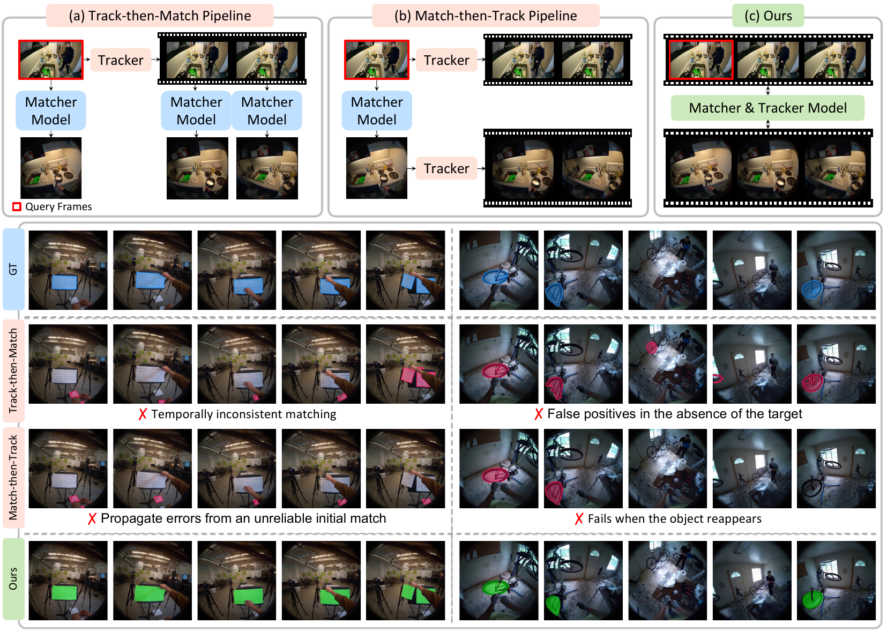
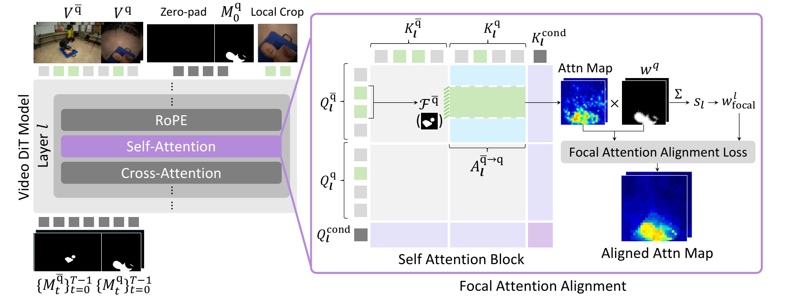
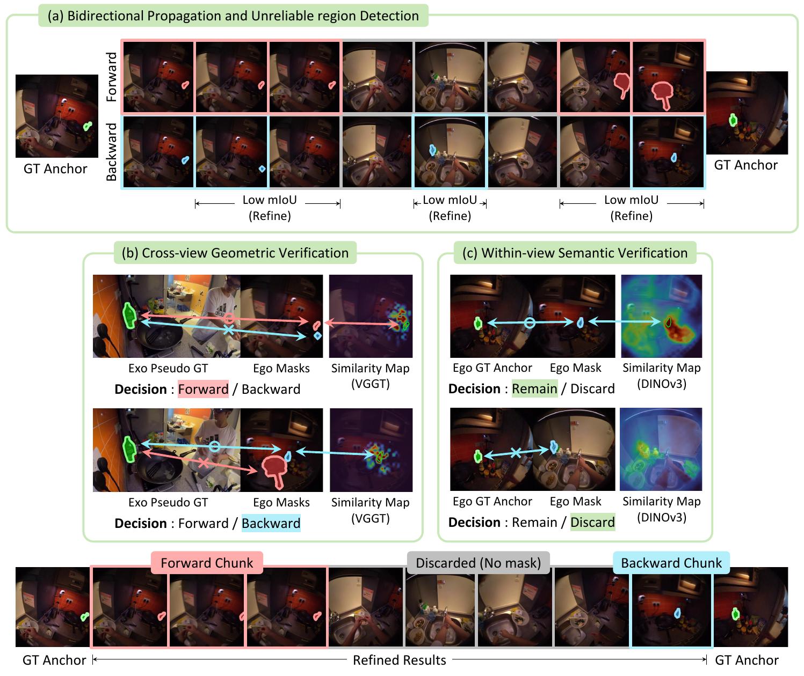

<h2 align="center"><strong>Repurposing Video Diffusion Transformers for Cross-View Temporal Object Correspondence</strong></h2>

<p align="center">
<a href="https://jinsy515.github.io/my-page/" target="_blank">Siyoon Jin</a><sup>*</sup>,
<a href="https://dhyun22.github.io/" target="_blank">Dahyun Chung</a><sup>*</sup>,
<a href="https://hg010303.github.io/" target="_blank">Honggyu An</a>,
<a href="https://sangbeomlim.github.io/" target="_blank">Sangbeom Lim</a>,<br>
<a href="https://wjnam6525.github.io/" target="_blank">Wonjin Nam</a>,
<a href="https://crepejung00.github.io/" target="_blank">Jaewoo Jung</a>,
<a href="https://wjun0830.github.io/" target="_blank">WonJun Moon</a>,
<a href="https://cvlab.kaist.ac.kr/home" target="_blank">Seungryong Kim</a>
</p>

<p align="center">
KAIST AI<br>
<sup>*</sup> Equal contribution
</p>

<h2 align="center">NeurIPS 2026</h2>

<p align="center">
  <a href="https://cvlab-kaist.github.io/XTrack/">
  </a>
  <a href="#">
  </a>
</p>

<p align="center">
  
</p>

## 📕 Abstract

> Cross-view object correspondence identifies the same object across views. However, existing methods treat this as a frame-level matching problem, necessitating a query mask at every frame. Furthermore, without modeling temporal context, they suffer from severe ambiguity under appearance changes or occlusions. Therefore, we introduce **cross-view temporal object correspondence**, which requires preserving object identity across both views and time from a query mask. To address this, we propose **XTrack**, a streamlined framework which repurposes a pretrained video DiT with semantic and spatiotemporal priors for RGB-to-mask latent transport, jointly modeling cross-view matching and temporal tracking. However, naive video DiTs do not guarantee accurate cross-view grounding and often attend to semantically similar yet incorrect objects across views. Thus, we introduce focal cross-view attention alignment, hard negative conditioning, and local context crop strategies to ensure reliable grounding. Finally, beyond these architectural enhancements, we also tackle the lack of dense annotation by introducing a pseudo-label curation pipeline that converts sparse Ego-Exo4D annotations into dense supervision to enable effective video-level training. Our highly competitive performances validate the effectiveness of XTrack as a streamlined framework, ensuring robust temporal consistency and identity preservation.

## 🧭 Task: Cross-View Temporal Object Correspondence

Given an ego video, an exo video, and a **first-frame query mask in one view**, predict temporally coherent masks of the same object in **both** views.
Depending on which view holds the query, the task is instantiated as **Ego2Exo** or **Exo2Ego**.
Unlike frame-level cross-view correspondence, no per-frame query is given: the model must preserve object identity across viewpoint changes, occlusion, disappearance and re-appearance.

## 🏗️ XTrack

<p align="center">
  
</p>

- **RGB-to-mask flow.** A pretrained video DiT is repurposed under flow matching with the transport endpoints redefined from noise→RGB to RGB→mask, keeping its spatiotemporal and semantic priors.
- **Unified ego-exo token space.** The ego and exo videos are placed side by side in one input, so cross-view matching and within-view tracking are modeled in the same attention.
- **Focal attention alignment.** Cross-view attention is supervised to land on the query object, with a focal weight that acts only when grounding is weak.
- **Hard negative conditioning.** The same videos are run with the correct query mask and with another object's mask; a margin loss keeps the two predictions apart.
- **Local context crop.** An object-centred crop is added as extra tokens with RoPE positions from its original coordinates, giving fine detail for small objects.
- **Two-stage training.** Image-level pretraining with a cycle-consistency loss, then video-level fine-tuning on curated pseudo-labels.

## 🏷️ Pseudo-Label Curation

Ego-Exo4D provides 30 FPS video but object masks only at 1 FPS. Our curation pipeline turns the sparse annotations into dense, verified 30 FPS pseudo-labels:

<p align="center">
  
</p>

1. **Bidirectional propagation** — forward and backward SAM2 between annotated anchors; chunks where the two propagations disagree are selected for verification.
2. **Cross-view geometric verification** — VGGT similarity to the static exo view selects the consistent candidate.
3. **Within-view semantic verification** — DINOv3 similarity to the first-frame ego anchor discards chunks that are still wrong.

## 📢 News

- **[2026/10]** Project page is online: https://cvlab-kaist.github.io/XTrack/
- **[2026/09]** XTrack is accepted to **NeurIPS 2026**!

## 📄 Citation

```bibtex
@inproceedings{xtrack2026,
  title     = {Repurposing Video Diffusion Transformers for Cross-View Temporal Object Correspondence},
  author    = {Jin, Siyoon and Chung, Dahyun and An, Honggyu and Lim, Sangbeom and Nam, Wonjin and Jung, Jaewoo and Moon, WonJun and Kim, Seungryong},
  booktitle = {Advances in Neural Information Processing Systems (NeurIPS)},
  year      = {2026}
}
```

<sub>Maintainer notes for regenerating the project page are in [`scripts/README.md`](scripts/README.md).</sub>
